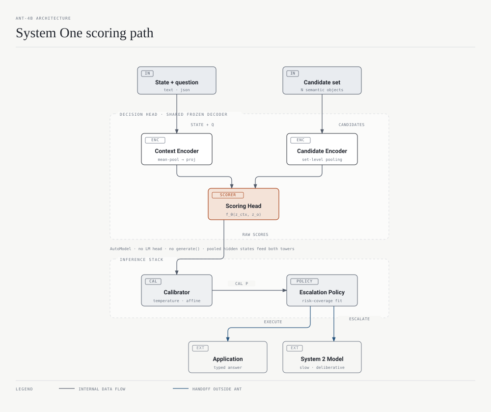
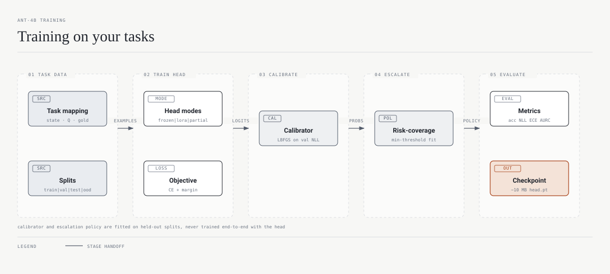

# ANT-4B: A Calibrated Candidate-Scoring Decision Model on a Decoder Backbone

**Adaptive Neural Triage on Qwen3.5-4B** — a System 1 decision model in the ecosystem opened by Jev and Laya.

## Abstract

ANT-4B repurposes the Qwen3.5-4B decoder as a calibrated candidate-scoring engine: it loads the backbone through `AutoModel` without the LM head, extracts the text decoder, and replaces generation with a single primitive, `score(state, question, candidate) -> scalar`, computed as `f_θ(C(S,Q), E(O_i))` where `C` and `E` are independent encoders over one shared frozen backbone. A calibrated choice over the same arbitrary, permutable candidate set applies temperature calibration and softmax outside the model, in `ANTPredictor.predict`, and confidence metrics feed an execute/escalate policy fitted on validation risk/coverage data; ANT never invokes a System 2 model itself, it only exposes the signal an external router needs. No component has a fixed class dimension, so N can range from 2 to 100+ and candidates are semantic objects (labels, sentences, serialized JSON). Training is cross-entropy over candidate scores in four modes (head-only/LoRA/partial/full), followed by post-hoc calibration (temperature by default) and escalation fitting. This paper situates ANT within the emerging System One model ecosystem (Jev, Laya), documents the architecture as implemented, describes three complementary training paths (ANT's own recipe, Laya's RLCD, the Unsloth decoder recipe), and reports the experiments completed so far: backbone verification (E-000), a mock-backbone smoke test passing 84/84 unit tests with permutation max |Δp| = 0.0 (E-001), and a mock training run reaching 0.61 test accuracy against ≈0.18 chance (E-002). All real-backbone results (E-101..E-105) are planned and stated as hypotheses. E-002 and the mock runs are exploratory evidence about the pipeline, not about model quality; no statistical significance is claimed anywhere in this paper.

---

## 1. Introduction

Dual-process theory distinguishes fast, automatic cognition (System 1) from slow, deliberate cognition (System 2) [22]. The LLM literature has imported this framing: surveys describe a spectrum from single-pass to multi-step deliberative systems [20, 21]. In 2025 and 2026 the framing became concrete as a product category. TypeSafe AI released Jev (2026-09-15), a proprietary, RLCD-trained model that the company calls a *System One decision model*: it receives a `state` (text, JSON, array) and typed questions and returns typed answers with probability estimates, for consumption by software rather than humans [4]. ConvAI Innovations followed with Laya, an open (Apache-2.0) decision model family trained with RLCD on encoder backbones [7, 8, 9].

The economic case for these models is the operating point they occupy. Non-generative pipelines (prompt a large LLM, parse its answer, retry when it hallucinates a class) spend tokens and latency on producing English as an intermediate representation for what is fundamentally a classification problem. A System 1 decision model skips the intermediate representation: it scores the provided options in one forward pass and returns probabilities that downstream code can threshold. The independent Jev evaluation runs 37 datasets for under USD 10 [6]; Laya reports ~33 ms per single question on a T4 [8]. And because these models emit calibrated probabilities rather than sampled text, they compose with the older literature on routing and cascades: a cheap System 1 decision layer can decide when to execute locally and when to escalate to an expensive System 2 model, like FrugalGPT [23], RouteLLM [24], Hybrid LLM [25] and speculative decoding [26].

ANT-4B contributes an open, decoder-based point on this spectrum. Its claim is narrow and testable: a 4B decoder's text encoder path, used through bi-encoder-style candidate scoring with a ~2.6M-parameter head, is a viable substrate for the same task Jev and Laya target, with two properties worth engineering for: candidate-order invariance (verified, not assumed [15]) and cacheable candidate embeddings that reduce steady-state inference to one context encoding plus N dot products.

## 2. Design: what ANT is and is not

ANT is not a chat model, a reranker over free text, or a classifier with a fixed output layer. It has three moving parts and a fixed contract between them:

1. `score(state, question, candidate) -> scalar` — the scoring primitive, computed as `f_θ(z_context, z_candidate)`.
2. the calibrated choice — softmax over the scores after post-hoc calibration, applied outside the model by `ANTPredictor.predict`.

3. execute/escalate — a confidence-metric policy over the distribution, defaulting to "always execute" because routing to System 2 belongs to the caller.

This section describes the architecture as implemented; every accuracy number in Sections 5a and 5b is a published ecosystem figure, and ANT's own real-backbone training (E-101..E-105) has not been run yet.

## 3. Related work

### 3.1 The System One model ecosystem

**Jev (TypeSafe AI, proprietary).** Released 2026-09-15 with a $40M seed round led by DCVC [5]. Jev accepts a `state` and typed questions (`noul` = true/false, `choice` = unordered options, `score` = ordered rubric) and returns typed answers with probability estimates; categories are provided at inference time, so it is zero-shot across tasks. Input limit is 64k tokens (32k for `state` plus the longest question). The name references the Jevons paradox and Kahneman's System 1 [4]. Its founder Diogo Almeida spent ~4 years at OpenAI on RLHF/InstructGPT/GPT-4 before founding TypeSafe in 2024 [5]; its training method is RLCD ("Reinforcement Learning for Calibrated Decisions", the company's term) [4, 5].

An independent evaluation of `jev-1.13.0` (Deußer, Sparrenberg, Sifa, arXiv:2609.37647) establishes several facts ANT cares about [6]: over 37 datasets and 346,009 requests for under USD 10, Jev reaches 95–99% on IMDB, SST-2, HellaSwag and ARC, 86.7% on Belebele across 122 languages, and beats Qwen3.8-27B on 27 of 37 datasets; choice probabilities are well calibrated and support selective prediction; accuracy is unchanged under option rotation; binary questions work with a near fixed-0.5 threshold, and threshold tuning raised UNFAIR-ToS micro-F1 from 0.50 to 0.75. Two of these findings directly shape ANT: order invariance is a property a decision model must be designed *and tested* for, and threshold placement is a fitting problem on validation data, not an architectural constant.

**Laya (ConvAI Innovations, open).** Apache-2.0, same request format as Jev (`state` + typed `choice`/`score`/`noul` questions), single forward pass at ~33 ms per question (7.2 ms/question batched on T4) [7, 8]. Three checkpoints share one head and training approach [8, 9]: `laya` on ModernBERT-large (421M params, 512 context), `laya-multilingual` on mmBERT-base (322M, 1024 up to 8k, ~2× faster, 100+ languages), and `laya-typed-decisions` on ModernBERT-large (421M, 1024 context). Positioning is explicit: "a fast base to specialise, not a zero-shot decision engine" [9]. Zero-shot on typed-decisions is near chance (0.36 vs 0.318 random); fine-tuned on ~30k questions it reaches 0.766 against Jev's published 0.727 and a 0.735 teacher ceiling [8, 9]. Training is RLCD against strictly proper scoring rules with GRPO-style policy gradient, on a Kaggle 2×T4 DDP run of 4–5 hours for 4 epochs [7]. A worked browser-agent fine-tune lifts element top-1 among ~45 candidates from 0.10 to 0.66 and real-task success from 0% to 62% [7]. Independent reports find Laya performing poorly on some benchmark suites (JevBench / Jev Decision Index) [16], which motivates the ecosystem-wide measurement effort of S1MB [14] and OpenDecider [13].

"Clef" appears in the Unsloth decision-model documentation as the third named decision model alongside Jev and Laya [11]; no independent evaluation of it is available in these notes, so this paper only uses it as the name of the head type in Unsloth's recipe (Section 5c).

Adjacent work in the ecosystem: the order-invariance study of Torchcast 12B, Kev 9B and Intern-Decision 4B (arXiv:2610.18233) [15]; JEV/Laya as a decision layer for penetration-testing agents with four mapped decision points [17]; Jev in aviation crash-narrative pipelines [18] and in agent workflows [19].

### 3.2 Decoder-as-encoder prior art

Using a causal decoder's hidden states for discriminative purposes is well established, and ANT sits inside that lineage rather than inventing it. Qwen3 Embedding uses last-token pooling over Qwen decoders to build embedding, reranking and classification models [27]. LLM2Vec conditions decoder-only models (attention to all tokens, MNTP + SimCSE contrastive tuning) into text encoders [28]. Reward models in the RLHF literature score `(prompt, response)` pairs with a scalar and train with the Bradley–Terry objective; the InstructGPT formulation is the closest structural analogue to ANT's scoring head, with candidates in place of responses [29, 30]. Sentence-BERT distinguishes bi-encoders (independent sentence encoding, cheap retrieval, cosine similarity) from cross-encoders (concatenated inputs, softmax scoring, more accurate per-pair but quadratic cost) [31]; ANT's Mode A is a bi-encoder and its roadmap Mode B (E-104) is the cross-encoder-style joint encoding. MMLU evaluation scores multiple-choice answers by log-probability of the answer token(s) rather than sampling [32], and lm-evaluation-harness generalizes exactly that pattern into a harness [33]. ANT's difference from all of these is the combination: a shared-decoder bi-encoder over *candidates of the decision task*, with a dedicated interaction head so scores are not restricted to cosine geometry, and calibration/escalation treated as first-class components.

### 3.3 Routing, cascades and selective prediction

FrugalGPT shows cascade thinking (cheap model first, expensive on demand) recovers GPT-4 parity at up to 98% cost reduction or +4% accuracy at equal cost [23]; RouteLLM demonstrates a router trained on preference data that transfers across black-box and open models with >2× cost reduction [24]; Hybrid LLM trains a router jointly with two model sizes [25]; speculative decoding achieves 2–3× latency reduction by drafting with a small model and verifying with a large one [26]. ANT's execute/escalate interface is the decision-layer version of the same trade, deliberately leaving the escalation target unspecified. On the policy side, Guo et al. established temperature scaling and ECE as the standard post-hoc calibration tools [34]; Geifman & El-Yaniv formalized selective classification with a coverage-risk framework [35] and SelectiveNet optimizes the select-function during training [36]; the reject option goes back to Chow [37]. ANT borrows selectively: its `RiskCoveragePolicy` sweeps validation thresholds and picks the smallest one meeting a stated risk budget [35], while calibration stays post-hoc rather than learned-in (Section 4.4).

## 4. Architecture

### 4.1 Backbone: Qwen3.5-4B as a text encoder

ANT uses [Qwen/Qwen3.5-4B](https://huggingface.co/Qwen/Qwen3.5-4B), verified against revision `851bf6e` (E-000) [1, 2]: ~4.66B parameters (~9.3 GB BF16 on disk, 2 safetensors shards), text hidden size 2560, 32 layers organized as 8 groups of 3 Gated DeltaNet linear-attention layers plus 1 full-attention layer (interval 4) [3], vocabulary 248,320 with tied embeddings, `max_position_embeddings` 262,144, FFN 9216. The Gated DeltaNet path needs `causal-conv1d` + `flash-linear-attention` on CUDA; without them transformers falls back to a correct but slow reference implementation.

Three decisions define how the checkpoint is loaded (`ant/backbone/qwen.py`):

```python
# ant/backbone/qwen.py:82-88 (class docstring)
"""Text-encoder view of a Qwen checkpoint: last hidden states, no LM head.

Loads the base model via ``AutoModel`` (never ``AutoModelForCausalLM``), so
the LM head and the generation path are never part of ANT. For multimodal
checkpoints the vision tower is dropped: only the text decoder is kept.
Starts frozen; training modes (LoRA/partial/full) unfreeze it explicitly.
"""
```

- **`AutoModel`, never `AutoModelForCausalLM`.** The checkpoint is multimodal (`Qwen3_5ForConditionalGeneration` with `text_config` + `vision_config`), so `AutoModel` loads `Qwen3_5Model` with children `visual` and `language_model`; `extract_text_decoder` locates the decoder by checking for a `layers` `ModuleList` plus `norm` along known paths (verified path: `("language_model",)`) and the vision tower is dropped from memory. No LM head is ever instantiated and there is no generation path to depend on.
- **Dynamic configuration.** Every dimension is read at load time (`resolve_hidden_size` handles both `text_config`-wrapped and flat configs); `ANTConfig` hard-codes nothing from the checkpoint.
- **Frozen by default, capped inputs.** `requires_grad_(False)` on load; gradient flow is enabled per-`encode` call only when some backbone parameter is trainable, so head-only training builds no autograd graph through the 4B parameters. Input length is capped at 8192 tokens (`ant/backbone/qwen.py:135`; `ANTConfig` defaults are tighter: 1024 context, 128 candidate), because the 262k window is irrelevant for triage.

### 4.2 Decision head: two encoders over one backbone

`ContextEncoder` and `CandidateEncoder` (`ant/encoding/context_encoder.py`, `ant/encoding/candidate_encoder.py`) share the backbone instance by reference, so only one copy of Qwen lives in memory. Each applies its own pooling (registry: `mean` masked-mean default, `last_token`, `max`, `attention` with a learned query), a `LayerNorm`, and a linear projection to `scoring_dim = 512`, and casts hidden states to FP32 so a BF16 backbone trains against a stable FP32 head. Inputs are wrapped in fixed templates (`ant/encoding/templates.py`):

```
<STATE>
{state}
</STATE>
<QUESTION>
{question}
</QUESTION>            # context, candidate-free
<CANDIDATE>
{candidate}
</CANDIDATE>           # one per candidate
```

Order invariance is a structural property, not an empirical hope. The candidate encoder embeds each candidate as an independent text input, and the scorer contract forbids positional or set-level information:

```python
# ant/scoring/base.py:6-13
class CandidateScorer(nn.Module):
    """Scores a context embedding against per-candidate embeddings.

    Input: z_context [B, d] and z_candidates [B, N, d]. Output: scores [B, N].
    Implementations must depend only on (z_context, z_candidate_i) pairs, never
    on candidate position or on the rest of the set: that is what guarantees
    permutation invariance and a variable number of candidates.
    """
```

Because no component has a fixed class dimension, N is bounded only by memory and token budget (E-001 verified N = 2, 3, 5, 9; N = 1 degenerates to probability 1.0), and duplicated candidates receive bit-identical scores with their label mass split across copies (`PredictionResult.probabilities` merges duplicates by summing).

### 4.3 Scoring functions

Four registered scorers consume `(z_context [B,d], z_candidates [B,N,d])` and produce `[B,N]`:

| Scorer | Form | Notes |
|---|---|---|
| `dot` | `z_c · z_i` | v0.1 baseline, zero-parameter |
| `cosine` | cosine(z_c, z_i) · e^α | learnable positive log-scale, init 2.77 (e^2.77 ≈ 16) because raw cosine ∈ [−1,1] is too narrow a logit range |
| `bilinear` | `z_c^T W z_i` | `W = I + 0.01·N(0,1)`, so training starts at the dot baseline |
| `mlp` | MLP over `[z_c, z_i, z_c ⊙ z_i, \|z_c − z_i\|]` | Linear(4d → 2d) + GELU + Linear → 1 |

```python
# ant/scoring/cosine.py:14-24 (excerpt)
self.log_scale = nn.Parameter(torch.tensor(2.77))  # e^2.77 ≈ 16
...
similarity = F.cosine_similarity(z_context.unsqueeze(1), z_candidates, dim=-1)
return similarity * torch.exp(self.log_scale)
```

All four are pairwise by construction; the MLP's interaction features are the richest but its `Linear(4d → 2d)` layer adds ~2.1M parameters at d = 512. The scorer comparison on real backbone weights is exactly experiment E-101 (Section 6).

### 4.4 Calibration

Softmax is applied *outside* the model, in the predictor, after an optional calibrator and a final user temperature knob:

```python
# ant/inference/predictor.py:104-106
def _probabilities(self, scores: torch.Tensor) -> np.ndarray:
    logits = self.calibrator(scores).float().detach() / self.temperature
    return torch.softmax(logits, dim=-1).cpu().numpy()
```

Available calibrators (`ant/calibration/calibrator.py`), fitted post-hoc on a validation split disjoint from test by NLL minimization (LBFGS for `temperature` and `vector_scaling`, Adam for `mlp`): `identity` (baseline), `temperature` (default), `vector_scaling` (per-logit affine s' = a·s + b), `mlp` (a shared per-candidate `g(s)`, non-monotone in principle). The variable-N setting determines which methods are meaningful:

- **Temperature is the only fully well-defined post-hoc method for variable N.** A single scalar T acts on every candidate identically and commutes with changing the candidate set.
- **A constant bias cancels in the softmax when N varies.** softmax(a·s + b) at variable cardinals = softmax(a·s), so `vector_scaling` keeps the code's bias parameter but only the scale is identifiable; it is retained as the softmax-invariant form of the method.
- **The MLP calibrator is applied per candidate score**, shared across candidates, so it preserves invariance and variable N; since monotonicity is not enforced, the code's own docstring says to validate it against temperature before adopting it.

Metrics are first-class, not afterthoughts: ECE, MCE, multiclass Brier, NLL, reliability diagrams, and risk-coverage curves with AURC/E-AURC (`ant/evaluation/`). Laya fits one temperature per question *type* after training [7]; ANT currently fits one global temperature because its objective is a single softmax over one set of candidates, not the three-typed-question API Jev and Laya use.

### 4.5 Escalation: confidence to execute/escalate

`compute_confidence_metrics` derives top-1 probability, margin (top1 − top2), raw entropy, and entropy normalized by log N from the calibrated distribution. Three policies consume them:

- `AlwaysExecute` — the default. ANT exposes every metric; the external System 1/2 router decides.
- `ThresholdPolicy(metric, threshold)` — execute when the metric clears the threshold, escalating on `confidence`/`margin` below (or `entropy`/`normalized_entropy` above) it.
- `RiskCoveragePolicy(target_coverage and/or target_risk)` — sweeps validation thresholds and returns the *smallest* feasible one, which maximizes coverage (automation) within the stated risk budget, following the selective-classification framing [35]. Its `fit` reports the achieved coverage, risk and automation accuracy; if no threshold satisfies the constraints it fails loudly instead of silently relaxing.

`scripts/train.py` fits the policy with `--target-risk 0.10` by default. ANT never calls a System 2 model: escalation is a signal, not an invocation.

### 4.6 Ragged batching and the MASK_SCORE constant

`ANTModel.forward(states, questions, candidates_per_row)` (`ant/model.py:109-136`) deduplicates candidates across the batch before encoding (one backbone pass per unique candidate), scatters embeddings back per row, pads to `N_max` with a boolean mask, and scores:

```python
# ant/model.py:15 and ant/model.py:135
MASK_SCORE = -1.0e9
...
scores = self.scorer(z_context, z_batch).masked_fill(~mask, MASK_SCORE)
```

`−1e9` rather than `−inf` is a deliberate choice: in BF16 and in padded numpy matrices a true `-inf` can produce NaNs through arithmetic, whereas −1e9 is softmax-neutral (its softmax mass is ~0) and casts safely. Padded score matrices therefore feed losses and calibrators directly without special-casing.

### 4.7 Candidate cache and amortized cost

`CandidateEmbeddingCache` (`ant/inference/cache.py`) is an optional LRU-bounded store of `candidate → z`. For a static candidate set, the runtime cost of a decision is **one context encoding + N dot products**; the backbone only runs again for cache misses. `predict_batch` exploits the same structure for the many-states/same-candidates case. This is the practical payoff of Mode A bi-encoder design, and the quantitative version is E-103 (`--batch-sizes 1 8 32 64 128`), whose recorded hypothesis is that amortized cost tends to one context encoding per state.



The figure above shows the full inference path as implemented. Two properties are worth pointing at. First, the context branch is candidate-free by construction: resizing the candidate set never changes `z_context`, which is what makes static candidate sets cacheable and order invariance provable. Second, everything between raw scores and the `execute`/`escalate` action is fitted on validation data (calibrator temperature, escalation threshold), so the model's output is a distribution plus a policy over it, not just an argmax.

### 4.8 Encoding modes: the Mode B extension point

Mode A, implemented throughout this paper, encodes the context and each candidate independently. Mode B is its designed counterpart on the roadmap: the joint template `CONTEXT_JOINT_TEMPLATE` is already defined in `ant/encoding/templates.py` (<STATE>/<QUESTION>/<CANDIDATE> in one string), and an encoder pair built on it would produce a candidate-conditioned context per candidate, extracting state information in the presence of the option text. The scorer interface (`[B, N, d] × [B, d]`) already accepts the resulting tensors, so Mode B slots in as an alternative `ContextEncoder`/`CandidateEncoder` pair without touching scoring, calibration, or escalation; E-104 is the experiment that decides whether the accuracy gain on hard negatives justifies losing the cache (Section 7).

This layering also defines where multimodality enters if ANT grows image inputs: the `ContextEncoder.format` stage is the injection point. An image-capable context encoder would build its backbone input from state text plus vision embeddings, and, because the context output remains `[B, d]`, nothing downstream changes. There is no multimodal implementation in this version of the code.

### 4.9 Effective defaults

Configuration is split across three dataclasses; these are the values a fresh run uses:

| Field | Default | Source |
|---|---|---|
| backbone | `Qwen/Qwen3.5-4B` | `ANTConfig.backbone_model` |
| scoring_dim | 512 | `ANTConfig.scoring_dim` |
| scorer / pooling | `dot` / `mean` (context and candidate) | `ANTConfig` |
| max_context_tokens / max_candidate_tokens | 1024 / 128 | `ANTConfig` |
| encode_batch_size | 8 | `ANTConfig` |
| user temperature knob | 1.0 (preserve fitted calibration) | `ANTConfig.temperature`, `ANTPredictor` |
| dropout | 0.0 | `ANTConfig.dropout` |

| Training field | Default | Source |
|---|---|---|
| mode | `head_only` | `TrainingConfig.mode` |
| epochs / batch / lr / weight_decay | 3 / 8 / 2e-4 / 0.01 | `TrainingConfig` |
| warmup_ratio / max_grad_norm | 0.05 / 1.0 | `TrainingConfig` |
| rank_weight (pairwise margin) | 0.0 (off) | `TrainingConfig.rank_weight` |
| LoRA r / alpha / targets | 8 / 16 / `q,k,v,o_proj` | `TrainingConfig`, `DEFAULT_LORA_TARGETS` |
| partial-mode last-k layers | 4 | `TrainingConfig.unfreeze_last_k_layers` |
| seed | 42 (trainer) / 7 (data CLI) | `TrainingConfig.seed`, `scripts/train.py --seed` |

| Synthetic benchmark field | Default | Source |
|---|---|---|
| splits | 1200 train / 300 val / 300 test / 100 OOD | `SyntheticConfig` |
| candidates per example | 4–6 | `SyntheticConfig.min/max_candidates` |
| difficulty weights (easy/medium/hard) | 0.40 / 0.35 / 0.25 | `SyntheticConfig.difficulty_weights` |
| non-English share | 15% train / 35% val / 50% test | `SyntheticConfig` |

Every field is overridable through the dataclasses or the `scripts/` flags; the values above are what a default `scripts/train.py` run uses.

## 5. Training a decision model on tasks

There are three complementary paths for turning a task into a trained decision model, and they are not exclusive: Sections 5a and 5b train the whole scoring behaviour, Section 5c is a recipe for reaching the same shape from the LLM side with a different head. ANT currently implements 5a; 5b and 5c are documented because they establish what the ecosystem considers the methods and the expected numbers.

### 5a. ANT's own recipe

**Task mapping.** A task becomes a stream of `DecisionExample(state, question, candidates, correct)` (`ant/types.py`). The state is the routing context as plain text; the question states what to decide; candidates are a variable-N, unordered list of *semantic objects* (department labels, sentence paraphrases, serialized JSON); `correct` must be one of them. Candidate sets may differ per example and may share items; everything downstream (ragged batching, dedup, masked scoring) handles that.

**Objective (`ant/training/losses.py`).** Masked cross-entropy on the correct candidate: padded slots sit at MASK_SCORE and contribute ~0 probability, so `F.cross_entropy(scores.float(), labels)` trains the softmax-over-scores objective directly. An optional pairwise margin term (hinge on `score(correct) > score(incorrect) + margin`, averaged over incorrect candidates, `rank_weight`, default 0.0) is wired in but off.

**Modes (`ant/training/modes.py`).**

| Mode | Trains | Notes |
|---|---|---|
| `head_only` | projections + pooling + scorer (~2.6M params at d=512) | v0.1 default; checkpoint ~10 MB |
| `lora` | PEFT adapters on the decoder targets `q/k/v/o_proj` (default r=8, α=16) + head | adapter saved next to the head |
| `partial` | last-k decoder layers (`unfreeze_last_k_layers=4`) + head | full-quality experiments at lower cost |
| `full` | everything | research only |

**Trainer (`ant/training/trainer.py`).** AdamW (lr 2e-4, wd 0.01), warmup ratio 0.05 then cosine decay via `LambdaLR`, bf16 autocast on CUDA (`amp=None` resolves to device type, off on CPU), gradient clipping at `max_grad_norm=1.0`, best-val-loss checkpointing. Two details matter for correctness with a frozen mixed-precision backbone: the backbone is kept in `.eval()` during training so dropout inside a partially unfrozen Qwen cannot perturb frozen-encoder reproducibility (`ant/training/trainer.py:106-110`), and checkpointing persists *only the head* (`head_state_dict` filters out every name containing "backbone."), with LoRA adapters alongside; the 9.3 GB backbone is never duplicated and is reloaded from the Hub on load.

**Checkpoint artifacts.** `ANTPredictor.save` writes one self-contained directory: `ant_head.pt` (head state dict + `ANTConfig` + `backbone_hidden_size`, plus the mock backbone weights only when the checkpoint is on MockBackbone), `config.json`, and `ant_head.pt`'s sidecar LoRA weights in `lora_adapter/` when LoRA was trained. The calibrator (`calibrator.pt`, name + state dict) is saved unless it is the identity calibrator, and the escalation policy (`escalation.json`) unless it is `AlwaysExecute`. `ANTPredictor.load` reconstructs model + calibrator + policy in the same order the pipeline applies them at inference (calibrate, then escalate, then the user temperature); `ANTModel.load` validates that the only missing keys are backbone keys and raises on any head mismatch, so a checkpoint can never load silently into a partially rebuilt model. The training and evaluation scripts additionally persist `training_report.json` and `metrics.json` (test and OOD rows) next to the weights.

**Commands.** `scripts/train.py` flags: `--backbone` (mock or HF id/path), `--scorer {dot,cosine,bilinear,mlp}`, `--mode`, `--epochs`, `--batch-size`, `--lr`, `--train-size/--val-size/--test-size`, `--seed`, `--no-calibration`, `--target-risk`, `--out`. After fitting, the script computes a validation score matrix, fits the temperature calibrator, fits the risk-coverage policy (`--target-risk`, default 0.10), evaluates test and OOD splits, and saves model + calibrator + policy in one directory for `ANTPredictor.load`. `scripts/evaluate.py --checkpoint ... --split {val,test,ood}` reports accuracy/NLL/Brier/ECE/AURC/E-AURC and optional reliability plots; `scripts/benchmark.py` runs the scorer sweep, the candidate-count scaling study (`--scaling-sizes`, default 2..32) and the batch-latency study (`--batch-sizes`, default 1, 8, 32).

**The development benchmark (`ant/data/synthetic.py`).** A deterministic multilingual customer-triage task: 6 departments with an explicit hard-negative graph (Billing ↔ Sales ↔ Customer Success plus Billing ↔ Customer Success; Tech Support ↔ Customer Success / Billing; Legal ↔ Security), three difficulties (hard states mention a confusable department while the gold label follows the strongest signal), five languages (en/it/es/fr/de) with candidates always in English, OOD departments (Facilities, Procurement) plus garbled inputs. Defaults: 1200 train / 300 val / 300 test / 100 OOD, 4–6 candidates per example, 15% non-English in train, 50% in test. E-002's OOD split showed exactly the shape the escalation design anticipates: low accuracy with visibly lower confidence.



### 5b. The Laya way: RLCD with proper scoring rules

Laya's fine-tuning path [7, 8] trains the same kind of model with a different optimization philosophy, and it is the strongest published template for baking calibration *into* training rather than fitting it afterwards:

- **RLCD (Reinforcement Learning from Calibrated Decisions, ConvAI's spelling):** reinforcement learning where the reward is a strictly proper scoring rule (log-loss / Brier family). The design premise stated in the repo: reporting honest probabilities is the *only* way to maximize reward under a strictly proper rule, so the policy cannot profitably over- or under-commit. GRPO-style policy gradient performs the update.
- **Recipe.** The decision head is reported as trained from scratch on top of a fully fine-tuned encoder [10]; the Kaggle 2×T4 DDP notebook builds the dataset → trains with GRPO → fits calibration temperatures → evaluates → pushes to Hub, in 4–5 hours for 4 epochs over ~30k questions. Apple Silicon users get an MPS script with micro-batching and gradient accumulation (`--micro-batch 1 --grad-accum 32` on 16 GB).
- **Calibration, with a sharp edge.** One temperature is fitted *per question type* (choice/score/noul) on held-out calibration samples, and inherited `temperature_by_options` buckets are removed from the exported config so a stale fit is not silently masked. The notebook's cautions: its calibration samples derive from training items, so evaluate on separate data.
- **Numbers.** Typed-decisions accuracy 0.36 zero-shot (0.318 random) → 0.766 fine-tuned, vs Jev's 0.727 and a 0.735 teacher ceiling. Browser-agent specialization [7]: element top-1 among ~45 candidates 0.10 → 0.66, real-task success 0% → 62% at 17–23 ms/step, from a data recipe of reverse-generated goals, executed DONE states, Mind2Web, and on-policy corrections.
- **Contrast with ANT.** ANT's cross-entropy over candidate scores trains the same softmax-over-candidates log-loss objective, but it treats the distributional honesty problem as a *post-hoc, architectural* question: a variable-N objective makes the calibration method itself a design decision (Section 4.4: only temperature is fully well-defined at variable N), and honesty is enforced by fitting on a held-out split with ECE/Brier/NLL gates rather than by the loss function during training. RLCD would presumably remove the need for that fitting step at the cost of running a policy-gradient loop; ANT's position is that for a head over a frozen 4B backbone, the NLL-fitted temperature is cheap and reproducible (E-002 fitted it on the validation split). This is a design bet, not a proven equivalence: the planned E-101..E-105 grid measures accuracy/ECE but does not include an RLCD arm yet.

### 5c. The Unsloth decoder recipe: Jev-shape from a small LLM

Unsloth's documentation [11] describes how to turn Qwen3.8 / Gemma 4 / Qwen3.5 LLMs into decision models "like Jev, Laya and Clef": a fine-tune with a **Clef head** producing choices plus probabilities, served through the Decisions API (model names `laya`, `default`, `jev-latest` can reroute to your model).

- **Recipe.** LoRA (official settings: 2 epochs, rank 16, lr 2e-4); the Qwen3.5-4B decision model trains on 8 GB VRAM [11, 12].
- **Data.** Rows with `state`, `questions` (instructions + criteria/options), `gold`; question types `choice`/`noul`/`score`; 12 datasets mixed (ag_news, arc, banking77, boolq, clinc150, commonsense_qa, mmlu, mnli, prompt_injections, snli, sst5, wanli) plus typed-decisions; test set 3,000 rows (2,000 typed-decisions + 500 BANKING77 + 500 CLINC150), decontaminated.
- **Numbers [11].** Qwen3.5-0.8B: typed-decisions 36% → 73%, BANKING77 7% → 74%, CLINC150 19% → 76%, holdout 78%. Qwen3.5-2B: 33% → 78% / 1% → 58% / 1% → 62%, holdout 81%.
- **Where it matches ANT and where it differs.** The shape is the same: decoder weights + a scoring head + softmax over provided options, no generation. ANT differs on three engineering axes: (i) bi-encoder structure with a candidate cache (Unsloth's recipe is effectively a per-question classification head; static candidate sets are re-encoded every time), (ii) post-hoc calibration with variable-N-aware semantics, and (iii) a first-class execute/escalate policy layer that the recipe leaves to the serving side. The recipe also demonstrates a fact ANT's roadmap relies on: decoders in the 0.8B-to-4B range are trainable as decision models on consumer VRAM, so bringing a 4B backbone into ANT with LoRA lands inside the published 8 GB envelope [11].

## 6. Experiments

Recorded exactly as filled in `EXPERIMENTS.md`. E-000 through E-002 are completed; E-101..E-105 are planned, with hypotheses stated *before* running, per the log's convention. No result below has been statistically tested; the mock-backbone numbers evidence the pipeline, not model quality.

**E-000 — Environment and backbone verification (2026-09-28, Apple M3).** Hypothesis: `AutoModel` exposes text hidden states without the LM head and all dimensions are config-readable. Procedure: fetched `config.json` (rev `851bf6e`), instantiated a random-init `Qwen3_5Config` on transformers 5.17/torch 2.14. Findings: multimodal wrapper, hidden 2560, 32 layers (3× linear + 1× full per group), vocab 248,320, 262,144 positions, tied embeddings, ~4.66B BF16 / ~9.3 GB; `language_model(input_ids, attention_mask)` → `[B, L, 2560]` with no LM head. Result: `QwenBackbone` built with dynamic resolution and decoder extraction. Conclusion: hypothesis confirmed; the "no LM head, no generate" constraint holds by construction.

**E-001 — Smoke test, mock backbone.** Hypothesis: the full forward/backward path satisfies permutation invariance, variable N, documented duplication semantics, and head-only gradient flow. Configuration: `ANTModel.tiny()` (MockBackbone h=64, scoring_dim=32, dot, mean pooling), 8 examples, single backward pass. Metrics: all 9 checks pass; permutation max |Δp| = 0.0; gradients reach 8 head tensors and 0 backbone tensors; N = 2,3,5,9 fine; duplicated candidates get identical probability. Result: **84/84 unit tests pass**, pipeline `train → calibrate → escalate → evaluate → reload` works end to end.

**E-002 — Mock training sanity run.** Hypothesis: the pipeline learns on the synthetic benchmark even with a toy backbone and calibration/escalation fit on real outputs. Configuration: `ANTModel.tiny()`, dot scorer, head_only; 300 train / 100 val / 100 test / 100 OOD (seed 7); 8 epochs, batch 8, lr 1e-2, AdamW + cosine. Metrics: test accuracy 0.61 (chance ≈ 0.18 at N ≈ 5.5), OOD accuracy 0.13 with lower confidence (abstention signal present), temperature fitted on val. Conclusion: pipeline-level success; absolute numbers meaningless (mock backbone); proceed to real-backbone CUDA runs.

**Planned (hypothesis stated, no results yet):**

| ID | Question | Recorded hypothesis |
|---|---|---|
| E-101 | Scorer comparison (dot/cosine/bilinear/mlp, frozen and LoRA) via `benchmark.py` | — |
| E-102 | Candidate-count scaling N = 2…128 | latency grows ~O(N) in cheap dot products; accuracy degrades gracefully with generic fillers |
| E-103 | Batch inference with cached candidates, batch 1…128 | amortized cost tends to one context encoding per state |
| E-104 | Joint encoding, Mode B (`CONTEXT_JOINT_TEMPLATE`, candidate-conditioned pooling) vs Mode A | Mode B may win accuracy on hard negatives at N× context-encoding cost, losing the cache advantage |
| E-105 | Multilingual calibration: ECE drift across en/it/es/fr/de for the E-101 winner | Qwen's multilingual representations keep calibration approximately stable, with mild degradation for it/de |

## 7. Limitations and threats to validity

- **Synthetic benchmark only.** Every completed number besides backbone facts comes from `ant/data/synthetic.py`. The benchmark has hard negatives and OOD splits, but department triage is only one task family, and results on it should not be generalized to task families like Laya's browser-agent specialization [7]. The roadmap lists real benchmarks as pending; the ecosystem's mixed reports about Laya, strong in its authors' typed-decisions suite [8, 9] and weak elsewhere [16], counsel against extrapolating any single-suite number.
- **Mode A encoding cost is O(N) without caching.** Each candidate costs one backbone pass at first sight; with an ad-hoc candidate set per decision there is no cache to amortize, and at N candidates the decision costs a context encoding plus N candidate encodes under a 4B backbone. Mode B (E-104) goes further: N context encodings per decision in exchange for candidate-conditioned accuracy. E-102/E-103 exist to quantify exactly this.
- **Zero-shot performance should be assumed near-chance for small heads.** The ecosystem's own evidence: Laya's zero-shot typed-decisions is 0.36 vs 0.318 random [8, 9], and its positioning is "a fast base to specialise". ANT's head-only mode (2.6M params over a frozen backbone) should be read under the same prior; its value case is the trained model plus the cache, not zero-shot transfer.
- **Permutation invariance must be tested, not assumed.** Jev's independent evaluation specifically verified option-rotation invariance [6], and a dedicated ecosystem paper [15] shows order-invariance failures are real in fine-tuned decision models. ANT's property is structural (pairwise scorers, candidate-free context, per-candidate calibration) and unit-tested with max |Δp| = 0.0 on the mock backbone; the real-backbone invariance check is part of the smoke test, and E-101's sweep carries it through all four scorers.
- **Multilingual calibration is an open question.** The benchmark keeps candidates in English while localizing states; E-105 will test whether ECE holds across languages or drifts for the it/de pair. If it drifts, a per-family or per-language temperature route exists but is not implemented.
- **Head-only training may underfit hard interactions.** Cross-entropy through a frozen 2560→512 bottleneck with zero-parameter scoring may cap what the `dot` scorer can express on genuinely novel task families; the LoRA/partial modes and the bilinear/MLP scorers are the designed remedies, and E-101 is the experiment that says whether they are needed.

## 8. Conclusion

ANT-4B is one concrete instantiation of the System One decision-model idea inside an open, decoder-based stack: Qwen3.5-4B as a frozen text encoder, a 2.6M-parameter scoring head with a pairwise contract that delivers permutation invariance and variable-N candidate sets for free, post-hoc calibration chosen for the variable-N setting, risk/coverage-fitted escalation, and head-only checkpoints that keep the backbone on the Hub. It runs where the ecosystem's recipes run: Laya fine-tunes in hours on 2×T4 [7], Unsloth trains a Qwen3.5-4B decision model in 8 GB VRAM [11], and ANT's head-only mode trains ~2.6M parameters over the same backbone, fitting the same class of hardware. What remains is measurement: the planned E-101..E-105 grid (scorers, N-scaling, cache amortization, joint encoding, multilingual calibration) converts this paper's design claims into numbers, and real benchmark suites beyond the synthetic triage task are the explicit prerequisite for any comparison with Jev, Laya, or the Unsloth recipes. The first mock-backbone experiments support a narrow conclusion only: the pipeline trains, calibrates, escalates and reloads with the invariance and gradient-flow properties it was designed for.

## References

1. [Qwen3.5-4B model card](https://huggingface.co/Qwen/Qwen3.5-4B) — 4B params, hidden 2560, 32 layers (8 groups of 3× Gated DeltaNet + 1× Gated Attention; GDN 32 V / 16 QK heads; GQA 16Q/4KV dim 256), FFN 9216, vocab 248,320, 262k context; MMLU-Pro 79.1, IFEval 89.8.
2. [M. Labonne, analysis of Qwen3.5](https://huggingface.co/blog/mlabonne/qwen35).
3. Gated DeltaNet (linear-attention lineage): [arXiv:2412.06464](https://arxiv.org/abs/2412.06464).
4. [Jev (AI model), Wikipedia](https://en.wikipedia.org/wiki/Jev_(AI_model)) — TypeSafe's term "System One decision model"; name references the Jevons paradox and Kahneman's System 1; zero-shot typed questions; 64k input limit; RLCD training.
5. [MindStudio, Jev System One model launch](https://www.mindstudio.ai/blog/jev-system-one-model-launch) — 2026-09-15 release, $40M seed (DCVC-led), Diogo Almeida background.
6. Deußer, Sparrenberg, Sifa, [Independent evaluation of Jev](https://arxiv.org/abs/2609.37647); benchmarking code: [github.com/AppliedMachineLearning-Lab/jev-benchmarking](https://github.com/AppliedMachineLearning-Lab/jev-benchmarking).
7. [Laya repository](https://github.com/NandhaKishorM/laya) (ConvAI Innovations, Apache-2.0) — fine-tuning README, RLCD/GRPO recipe, Kaggle 2×T4 and MPS scripts; browser-agent case study at `docs/finetune_browser_agent.md` in the repo.
8. [Laya model card](https://huggingface.co/convaiinnovations/laya) — ModernBERT-large 421M and mmBERT-base 322M checkpoints, ~33 ms forward pass, zero-shot 0.36 / fine-tuned 0.766.
9. [Laya typed-decisions model card](https://huggingface.co/convaiinnovations/laya-typed-decisions).
10. [multimodalart/jev-reproductions-tracker](https://huggingface.co/multimodalart/jev-reproductions-tracker) — Laya decision head trained from scratch on top of a fully fine-tuned encoder.
11. [Unsloth docs, "Train your own Decision Model with Unsloth"](https://unsloth.ai/docs/basics/train-your-own-decision-model-with-unsloth) — Clef head, LoRA r=16 / 2 epochs / lr 2e-4, dataset format, mixed-task results (0.8B: 36%→73% typed-decisions, 7%→74% BANKING77, 19%→76% CLINC150; 2B: 33%→78% / 1%→58% / 1%→62%), Qwen3.5-4B decision model on 8 GB VRAM.
12. [Unsloth Qwen3.5-4B Decision notebook](https://colab.research.google.com/github/unslothai/notebooks/blob/main/nb/Qwen3_5_(4B)-Decision.ipynb).
13. [OpenDecider — open calibrated decision models compared with Jev, Laya, Stanford/NVIDIA CLM-8B](https://huggingface.co/blog/manjunathshiva/opendecider-beats-laya-and-jev).
14. [S1MB — System One decision models across 100+ benchmarks](https://huggingface.co/blog/hotchpotch/system-one-mosaic-benchmark).
15. ["Consider, Then Choose: Order-Invariant Decisions in System One Models"](https://arxiv.org/abs/2610.18233).
16. [Laya discussion #10 — JevBench / Jev Decision Index reports](https://huggingface.co/convaiinnovations/laya/discussions/10).
17. Barbosa, [JEV/Laya as decision layers for penetration-testing agents](https://arxiv.org/abs/2609.28940).
18. Rafe, Das, [Crash narratives + Jev](https://arxiv.org/abs/2609.24052).
19. Rafe, Das, [Jev in agent workflows](https://arxiv.org/abs/2610.13092).
20. [From System 1 to System 2 (survey)](https://arxiv.org/abs/2502.17419).
21. [Reasoning on a Spectrum](https://arxiv.org/abs/2502.12470).
22. D. Kahneman, *Thinking, Fast and Slow* (2011) — dual-process System 1/System 2 framework.
23. [FrugalGPT — LLM cascades](https://arxiv.org/abs/2305.05176).
24. [RouteLLM](https://arxiv.org/abs/2406.18665).
25. [Hybrid LLM — cost-aware routing across two model sizes](https://arxiv.org/abs/2404.14618).
26. [Speculative decoding (draft + verify)](https://arxiv.org/abs/2211.17192).
27. [Qwen3 Embedding — decoder-as-encoder with last-token pooling](https://arxiv.org/abs/2506.05176).
28. [LLM2Vec — decoder-only models as text encoders](https://arxiv.org/abs/2404.05961).
29. [InstructGPT](https://arxiv.org/abs/2203.02155) — reward-model formulation with the Bradley–Terry objective.
30. [RLHF Book, chapter 5: Reward Models](https://rlhfbook.com/c/05-reward-models).
31. [Sentence-BERT — bi-encoder vs cross-encoder](https://arxiv.org/abs/1908.10084).
32. [MMLU — log-probability multiple-choice scoring](https://arxiv.org/abs/2009.03300).
33. [lm-evaluation-harness](https://arxiv.org/abs/2306.13398).
34. Guo et al., [On Calibration of Modern Neural Networks](https://arxiv.org/abs/1706.04599) — temperature scaling, ECE.
35. Geifman, El-Yaniv, [Selective Classification for Deep Neural Networks](https://arxiv.org/abs/1705.08500).
36. [SelectiveNet](https://arxiv.org/abs/1901.09192).
37. C. K. Chow (1970), *On optimum recognition error and reject tradeoff*, IEEE Trans. Information Theory — the reject option.
